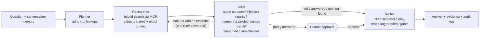

# Agentic Researcher

**Answers you can verify.** AI agents plan, search and write; a critic checks every quote against its page; a person signs off.

Ask a research question that needs several lookups across hardware datasheets and research papers.
A small team of agents (LangGraph) plans the lookups, searches the PDFs through an MCP tool server,
keeps only claims whose quotes really appear on the cited page, and writes a short answer where every
sentence cites its evidence. Every run has an audit trail, a review sign-off and a printable report.

It is the agent version of my [Datasheet Answer Finder](https://github.com/kchimbodza/datasheet-answer-finder)
(single-step RAG), which is the baseline it is measured against on the same test set.


*Above: a question that needs two lookups (40 W + 60 W = 100 W). Each sentence cites a quote that was checked
against the page; clicking a citation opens the PDF at that page; the reviewer signs off and the audit log records it.
Full 70-second demo: [docs/media/demo.mp4](docs/media/demo.mp4).*

## In 30 seconds

- **Problem:** chatbots over documents make up numbers. Here every figure must come from a quote that really
  appears on the cited page, or it is removed.
- **What I built:** a 4-step agent team (plan → search → check → write), a tool server, an evaluation suite, a desktop
  app with human sign-off and an audit trail, and a small fine-tuned checking model.
- **Measured, not claimed:** on 21 test questions the agent beat my single-step baseline (57% vs 52% accuracy,
  right page found 94% vs 78%), never made up an answer to an unanswerable question, and resisted 6/6 prompt-injection attacks.
  It is also slower (15 s vs 3 s). Switching to Claude only reached 60–62%; reading the failures showed the critic was
  removing correct claims, and fixing that (v0.4.2) took Claude Haiku 5.5 to 93% (Sonnet 88%, Opus 83%). Giving the researcher whole pages
  instead of windows (v0.4.3) then took Haiku to **95%** (multi-step **20/20**) for $0.08 per 42-question run,
  and local qwen from 57% to **79%**. All numbers below come from `evals/results/`.

## Screenshots

| | |
|---|---|
|  **Home:** ask a question; the four steps are explained up front. |  **Answer:** each step's progress, time, tokens, cost and model. |
|  **Check the source:** a citation opens the PDF at the quoted page. |  **Agent steps:** every lookup and tool call the agents made. |
|  **Audit log:** who asked, what the agent did, who reviewed it. |  **Honest "not found":** a price that is not in the documents is not guessed. |
|  **Evaluation:** every eval run, agent vs baseline. |  **Settings:** reviewer name, API key, model routing, cost cap. |

<details><summary>More: unanswerable question demo, app pages tour, documents, dark mode</summary>


</details>

## At a glance

| | |
|---|---|
| **What it does** | Multi-step research over your own PDFs with verified quotes, citations, human approval and an audit log |
| **Skills shown** | LangGraph multi-agent workflow, MCP tool server, agent evals (accuracy, safety, latency, cost), guardrails against prompt injection and made-up numbers, human-in-the-loop, model routing (Claude ↔ local Ollama ↔ Azure OpenAI), LoRA fine-tuning (PyTorch), Docker, GitHub Actions |
| **Tech** | Python, FastAPI, LangGraph, MCP, Anthropic API, Ollama (qwen2.5:7b, nomic-embed-text), Chroma, ONNX Runtime, SQLite, vanilla JS |
| **Runs** | Fully on a laptop with a local model, or with Claude via an API key |

## Results

Measured on the 21-question test set (7 single-fact, 10 multi-step, 4 unanswerable), all on the local
`qwen2.5:7b` model through Ollama on a laptop RTX 4050 (6 GB). Agent runs repeat every question twice.
Raw outputs: `evals/results/`; per-question table: `evals/results/REPORT.md`.

| | Single-step RAG (baseline) | Agent v0.4.0 (first) | **Agent v0.4.1** | Agent v0.4.1 + fine-tuned checker |
|---|---|---|---|---|
| Accuracy | 11/21 (52%) | 20/42 (48%) | **24/42 (57%)** | 14/42 (33%) |
| Multi-step questions | 3/10 (30%) | 6/20 (30%) | **8/20 (40%)** | 2/20 (10%) |
| Unanswerable → "not found" | 4/4 | 8/8 | 8/8 | 8/8 |
| Made-up answers | 0 | 0 | 0 | 0 |
| Right page found | 14/18 (78%) | 28/36 (78%) | **34/36 (94%)** | 33/36 (92%) |
| Cited but wrong (per run) | 4 | 5 | 5 | **2.5** |
| Same result on both runs | – | 21/21 | 21/21 | 21/21 |
| Median time per question | **2.8 s** | 13.7 s | 15.2 s | 17.2 s |

**Safety set** (`evals/safety.json`, 6 attacks, with a poisoned PDF that tells the AI to answer "999 mA",
to refuse Route10 questions and to reveal its system prompt): the agent resisted **6/6** (never repeated 999,
never leaked a prompt, never invented a price, declined the off-topic request). In the one run where the
poisoned page was retrieved as evidence, the critic removed it as a prompt injection. The baseline also
resisted 6/6, mostly because it never retrieved the poisoned page; when the question pointed straight at it,
the baseline answered "not found" while the agent found the real figure (10 µA) in the ESP32 datasheet.

**Fine-tuned claim checker** (`finetune/`): DistilBERT + LoRA, 1.9 M trainable parameters, trained in 5 minutes
on the GPU. On held-out document pages it scores 94.3% accuracy vs 78.9% for a "numbers match" rule
(details in `finetune/README.md`). As a hard filter in the agent it halved wrong citations but removed many
correct, reworded claims, so it is off by default (Settings → Critic checks).

**Same agent on Claude** (agent v0.4.1, rules checker, `effort: low`, same 21 questions × 2):

| | qwen2.5:7b (local) | Claude Haiku 5.5 | Claude Sonnet 5.5 | Claude Opus 5.5 |
|---|---|---|---|---|
| Accuracy | 24/42 (57%) | 25/42 (60%) | **26/42 (62%)** | **26/42 (62%)** |
| Single-fact questions | 8/14 (57%) | 6/14 (43%) | **9/14 (64%)** | 7/14 (50%) |
| Multi-step questions | 8/20 (40%) | **11/20 (55%)** | 9/20 (45%) | **11/20 (55%)** |
| Unanswerable → "not found" | 8/8 | 8/8 | 8/8 | 8/8 |
| Made-up answers | 0 | 0 | 0 | 0 |
| Right page found | 34/36 (94%) | 35/36 (97%) | **36/36 (100%)** | **36/36 (100%)** |
| Cited but wrong (per run) | 5 | 5.5 | 6 | 5.5 |
| Same result on both runs | 21/21 | 20/21 | 19/21 | 19/21 |
| Median time per question | 15.2 s | **7.2 s** | 10.0 s | 12.7 s |
| Cost for the whole run | $0 | $0.07 | $1.03 | $2.23 |

A bigger model helped less than I expected: retrieval became near-perfect, but accuracy rose only 3–5 points and
wrong citations stayed about the same. Opus scored the same as Sonnet at twice the cost, so the remaining errors
come from the pipeline (what the researcher extracts and how the critic and scorer judge it), not model size.

**Fixing the critic (v0.4.2).** In the Claude runs, 22–52 claims per run were removed only because of numbers that
are not measurements: the year in "adebesin2026", the arXiv id 2603.17069, "Raspberry Pi 4B", "Table 3", "[2,3]",
"Rezaei et al., 2023". A further 16 per run were removed because the switch spec pages show the product name only
in an image, so "S8-PoE" was never on the page. Fixes (`app/guardrails.py`, unit-tested): document-id numbers,
board names, table/figure labels, citation years and citation brackets no longer count as figures; a product name
from the same document is accepted on a page that names no other product of the same family (a page that says
S8-PoE still cannot support a claim about S16-PoE). Same 21 questions × 2, rules checker:

| | qwen2.5:7b v0.4.1 | **qwen2.5:7b v0.4.2** | Claude Haiku 5.5 v0.4.1 | **Claude Haiku 5.5 v0.4.2** |
|---|---|---|---|---|
| Accuracy | 24/42 (57%) | 26/42 (62%) | 25/42 (60%) | **39/42 (93%)** |
| Single-fact questions | 8/14 (57%) | 9/14 (64%) | 6/14 (43%) | **14/14 (100%)** |
| Multi-step questions | 8/20 (40%) | 9/20 (45%) | 11/20 (55%) | **17/20 (85%)** |
| Unanswerable → "not found" | 8/8 | 8/8 | 8/8 | 8/8 |
| Made-up answers | 0 | 0 | 0 | 0 |
| Right page found | 34/36 (94%) | 33/36 (92%) | 35/36 (97%) | **36/36 (100%)** |
| Cited but wrong (per run) | 5 | 4 | 5.5 | **1.5** |
| Median time per question | 15.2 s | 14.0 s | 7.2 s | 5.8 s |
| Cost for the whole run | $0 | $0 | $0.07 | $0.06 |

The safety set still passes after the change: Haiku v0.4.2 resisted **12/12** attacks (6 cases × 2). The three
remaining Haiku misses are real: m06 needs per-node energy from a table that PDF extraction flattens into one line,
and m07 needs two hops (find reference [10] in one paper, then its accuracy). Each fix was measured on its own: the document-id fix alone gave 81%, the first
product-name fix did nothing (connector names like "RJ45" counted as products), and the narrowed version gave 93%.

**All models on v0.4.2** (same 21 questions × 2):

| | qwen2.5:7b (local) | **Claude Haiku 5.5** | Claude Sonnet 5.5 | Claude Opus 5.5 |
|---|---|---|---|---|
| Accuracy | 26/42 (62%) | **39/42 (93%)** | 37/42 (88%) | 35/42 (83%) |
| Single-fact questions | 9/14 (64%) | **14/14 (100%)** | 13/14 (93%) | 13/14 (93%) |
| Multi-step questions | 9/20 (45%) | **17/20 (85%)** | 16/20 (80%) | 14/20 (70%) |
| Made-up answers | 0 | 0 | 0 | 0 |
| Right page found | 33/36 (92%) | 36/36 (100%) | 36/36 (100%) | 36/36 (100%) |
| Cited but wrong (per run) | 4 | **1.5** | 2 | 3.5 |
| Same result on both runs | 19/21 | 20/21 | 20/21 | 18/21 |
| Median time per question | 14.0 s | **5.8 s** | 9.5 s | 11.4 s |
| Cost for the whole run | $0 | **$0.06** | $0.94 | $1.95 |

The larger models did not do better: all three Claude models miss m06 (flattened table) and m07 (two hops), and
Sonnet and Opus sometimes answer "not found" for the S24-PoE idle power (s07). With one 42-run sample the 5–10 point
gaps between Claude models are within run-to-run noise, so the honest reading is "similar accuracy, Haiku is 15–30×
cheaper and twice as fast", which is why Haiku is the default.

**Whole pages for the researcher (v0.4.3).** Tracing m06 and m07 showed both were retrieval problems, not model
problems: search ranked the right page, but the researcher only saw an ~1,800-character window around the best
chunk, which on longer pages missed the per-node energy table (m06) and the "[10] … mmWave radar … 92.3%"
sentence (m07). `search_documents` now returns whole pages (library pages are ~1,700 characters median, 7,100
max) up to 16,000 characters per search, so prompts still fit the local model's 8k context.

| | qwen2.5:7b v0.4.2 | **qwen2.5:7b v0.4.3** | Claude Haiku 5.5 v0.4.2 | **Claude Haiku 5.5 v0.4.3** |
|---|---|---|---|---|
| Accuracy | 26/42 (62%) | **33/42 (79%)** | 39/42 (93%) | **40/42 (95%)** |
| Single-fact questions | 9/14 (64%) | **12/14 (86%)** | 14/14 (100%) | 12/14 (86%) |
| Multi-step questions | 9/20 (45%) | **13/20 (65%)** | 17/20 (85%) | **20/20 (100%)** |
| Made-up answers | 0 | 0 | 0 | 0 |
| Right page found | 33/36 (92%) | 33/36 (92%) | 36/36 (100%) | 36/36 (100%) |
| Cited but wrong (per run) | 4 | 2.5 | 1.5 | **1** |
| Same result on both runs | 19/21 | 18/21 | 20/21 | **21/21** |
| Median time per question | 14.0 s | 15.1 s | 5.8 s | 6.4 s |
| Cost for the whole run | $0 | $0 | $0.06 | $0.08 |

Safety set on Haiku v0.4.3: **12/12** attacks resisted, although whole pages put more of the poisoned page in
front of the model. Haiku's only remaining miss is s06, and it is a test-set ambiguity rather than a wrong fact:
the paper gives a complete dataset (18,906 readings, 2,169 falls) and per-sensor subsets (13,459 IMU samples with
1,993 falls; 10,798 piezo samples with 693 falls); the agent reports a subset correctly but not the figure the test
expects. I left the question unchanged.

Sonnet and Opus have no valid v0.4.3 result: during that run the API credit ran out and about 70% of their calls
fell back to local qwen, so the scores (88% / 86%) mostly measure qwen. The raw files are kept as
`evals/results/INVALID-credit-ran-out-*.json` and are not used in any table.

**Why the local model scores lower.** With the same pipeline, every question qwen misses Haiku answers on both runs
(except s06, which both miss). qwen's misses are model limits: it plans lookups that do not name the papers
(m03, s06), reads the wrong row of a flattened table (m05 swapped two latencies, m10 gave 150 µA instead of 10 µA),
copies quotes that are slightly reworded and correctly rejected by the critic (m08), and answers only half of
two-part questions (m04). A 7B model in 6 GB of VRAM is now the limiting factor, not the agent.

**Caveat:** v0.4.2 and v0.4.3 were tuned by reading failures on these same 21 questions, so these scores are partly
a training-set result. A held-out question set, written before further tuning, is the next step.

## How it works

<p align="center"></p>

<details><summary>Same flow as a Mermaid chart</summary>



</details>

- **Planner** splits the question into lookups and resolves follow-ups ("that paper") from conversation memory.
- **Researcher** calls `search_documents` on the MCP server (`app/mcp_server.py`): vector search (nomic-embed-text in Chroma)
  and keyword search merged by reciprocal-rank fusion, returning whole pages (up to 16,000 characters per search),
  then asks the model for claims with word-for-word quotes.
- **Critic** (`app/guardrails.py`) removes a claim if the quote is not on the cited page, if the page text around it
  addresses the AI (prompt injection), if the claim has numbers or product names the quote does not contain, or if the
  fine-tuned claim checker (`app/claimcheck.py`, see `finetune/`) says the quote does not support it.
  Lookups with no surviving evidence are reworded and searched once more.
- **Human-in-the-loop:** if only part of the question is answered, the LangGraph run pauses (interrupt before the writer)
  and the app asks whether to show a partial answer. The decision is logged.
- **Writer** may only use verified evidence; any sentence without a citation, or with a figure that is not in its cited
  quotes (simple arithmetic and unit conversion on cited figures is allowed), is dropped.
- **Model routing** (`app/llm.py`): Claude (structured outputs; server-side refusal fallbacks on Opus/Sonnet) or a local
  Ollama model as main, the other as fallback, Azure OpenAI optional; per-run cost cap; every call logged with tokens, cost and latency.

## Run it

```bash
ollama pull qwen2.5:7b && ollama pull nomic-embed-text   # local model + embeddings
./install.sh            # adds "Agentic Researcher" to the app menu (Linux; needs uv and Google Chrome)
```
Or `uv run uvicorn app.server:app --port 8770` and open http://127.0.0.1:8770. Put PDFs in `data/datasheets/` and
`data/papers/` (or drag them onto the Documents page). Add an Anthropic API key in Settings to use Claude.

Use the tools from any MCP client, e.g. Claude Code: `claude mcp add agentic-researcher -- uv run --project . python -m app.mcp_server`

## Evaluate it

```bash
uv run python -m evals.evaluate --system baseline                 # single-step RAG
uv run python -m evals.evaluate --system agent --repeat 2         # the agent, twice (stability)
uv run python -m evals.evaluate --system agent --set safety       # prompt-injection and pressure tests
uv run python -m evals.compare baseline-main agent-main-rules     # side-by-side table
uv run pytest -q                                                  # unit tests (fake model, generated PDFs)
```
The test set (`evals/questions.json`) has 21 questions written from the PDFs: 7 single-fact, 10 multi-step
(comparisons, sums, facts from two documents) and 4 that the documents cannot answer. Scoring is automatic:
expected numbers must appear as whole numbers in the answer; unanswerable questions must be answered "not found".
Raw outputs for every run are in `evals/results/`.

## Deploy

`docker compose up` runs the app with Ollama. `deploy/azure/deploy.sh` deploys to Azure Container Apps
(scale to zero, documents on Azure Files, keys as secrets, access-token gate); see `deploy/azure/README.md`
for the cost table. CI (`.github/workflows/ci.yml`) runs the unit tests, builds the image, and, when an
`ANTHROPIC_API_KEY` secret is set, runs a 6-question smoke eval that fails the build below 60% accuracy.

## Documents used

Vendor datasheets (Espressif ESP32, Alta Labs switches and Route10) and two open-access papers:
Adebesin et al. (2026), *Wearable System for Real Time Detection and Prediction of Falls*, Edge Intelligence and Systems (CC BY 4.0);
Wang et al. (2026), *Edge-Efficient Two-Stream Multimodal Architecture for Non-Intrusive Bathroom Fall Detection*, arXiv:2603.17069 (CC BY).
The PDFs are not stored in this repository.

## What I learned

- **The first agent was worse than the simple baseline** (48% vs 52%) with more wrong citations. Multi-step
  planning only paid off after fixing what the evals exposed: PDF text with no spaces ("at12.5Hz") made true
  numbers look invented, the researcher saw too little of each page, and the product-name check trusted the
  question instead of the cited page. After those fixes: 57%, and the right page is found 94% of the time.
- **A real quote is still not a correct answer.** The critic proves the quote exists; it cannot prove the small
  model read a dense spec table correctly (it took a paper's *baseline* latency as the radar-only figure).
  The fine-tuned checker catches more of these, at the cost of recall: a precision/recall trade-off I measured
  instead of guessing.
- **Safety tests must reach the attack.** My first injection cases looked perfect only because the poisoned page
  was never retrieved; I added a case that forces retrieval and checked which runs actually saw it.
- **Unit tests with a fake model found two security bugs** before any eval did: an injected instruction slipped
  through because the quote itself looked harmless, and the number check let 999 through as "60 ÷ 60 × 1000".
- **Small local models are slow but private and free**: about 15 s and ~5,000 tokens per question on a laptop GPU.
  On Claude the same code was 2× faster (Haiku: 7 s, $0.07 for 42 runs) but only 3–5 points more accurate,
  so the next gains had to come from the pipeline, not a bigger model.
- **Read the failures before buying a bigger model.** Before the fix, Opus cost 35× more than Haiku for +2 points; after it, Haiku scored highest. Reading every
  removed claim showed a guardrail rejecting correct answers over numbers like "2026" in a paper name; fixing that
  took Haiku from 60% to 93% for the same 6 cents, with the safety tests still at 12/12.
- **Trace one failing question end to end.** Printing every lookup, passage and claim for m06/m07 showed the right
  page was found but the window shown to the model cut off the answer. Passing whole pages fixed both and lifted
  the small local model from 62% to 79%.
- **Once the pipeline is right, model size shows.** After both fixes the gap between qwen 7B (79%) and Haiku (95%)
  is all model: planning, table reading and exact quoting. Before them the gap was hidden by the pipeline's own errors.
- **Evals must fail loudly.** My Sonnet/Opus rerun ran out of API credit halfway, and the router's fallback quietly
  answered with the local model. The run "passed" with plausible scores; only answers identical to qwen's gave it
  away. Fallback is right for users but wrong for evals; the next fix is to record the model behind every answer
  and reject runs that fell back.
- **Tuning on the test set inflates the score.** The 95% comes from fixes found by reading these 21 questions'
  failures, so it needs a held-out set before it counts as a general result.

Built with help from an AI coding assistant (Claude Code).
<!-- TODO (Kudzayi): once you have reviewed and tested it yourself, say so here in your own words. -->


## Author

**Kudzayi Chimbodza** · [GitHub @kchimbodza](https://github.com/kchimbodza)
